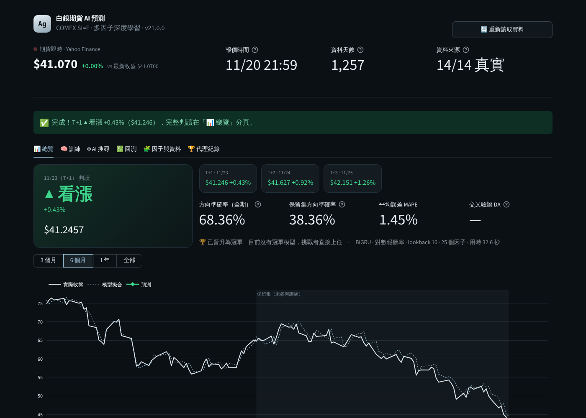

# Silver AI Trader — Python 版（V21）

白銀期貨（COMEX **SI=F**）多因子深度學習預測系統，由 HTML／TensorFlow.js 版移植成 **Python + Streamlit + PyTorch**，並重新設計介面。

**網址：https://silver-ai.streamlit.app/**



> 總覽截圖為 2026-11-22 以真實行情實際執行的結果（BiGRU、對數報酬率、200 epochs）；其他截圖使用測試用的假資料。

## 🌐 部署成網站（Streamlit Community Cloud，免費）

Python 版在伺服器上抓資料，**沒有瀏覽器 CORS 的限制**，不需要任何 proxy 或中繼。2026-11 實測 14 個資料來源全部取得真實資料，完整載入約 5 秒。

1. 到 https://share.streamlit.io 用 GitHub 帳號登入，授權讀取 `frk618-ship-it/silver-ai-trader`。
2. 按 **Create app** → **Deploy a public app from GitHub**（或「Yup, I have an app」）。
3. 填入：

   | 欄位 | 值 |
   | --- | --- |
   | Repository | `frk618-ship-it/silver-ai-trader` |
   | Branch | `main` |
   | Main file path | `python/app.py` |
   | App URL | 自訂，例如 `silver-ai` → `https://silver-ai.streamlit.app` |

4. 展開 **Advanced settings**，Python version 選 **3.12** → **Deploy**。第一次安裝套件約 3–5 分鐘。
5. （建議）部署後在 App 的 **Settings → Sharing** 設成只有指定 email 可以看。所有訪客會共用同一份模型與預測紀錄。

雲端版的注意事項：

- **模型與紀錄**：App 休眠或重新部署時伺服器硬碟會清空；設定下方的「保存模型」後會自動備份與還原。
- **速度**：免費主機 CPU 較少。標準 400 epochs 約 20 秒（LSTM／Transformer／TimesFM）到 70 秒（BiGRU）。
- **相依套件**：`requirements.txt` 指定只裝 CPU 版 PyTorch，避免下載用不到的 GPU 函式庫。

## 💾 保存模型（自動備份到 GitHub）

雲端主機的硬碟是暫時的，休眠、重新部署後模型與紀錄會清空。設定後：

- **自動備份**：每次訓練或預測完成，系統會把以下內容打包成 `silver-state.zip`，存到你的私人 repo。內容沒變化就不備份，所以不會產生多餘的 commit。
  - 冠軍模型、最近一次訓練的模型
  - 預測紀錄、設定
- **自動還原**：App 重新啟動、本機沒有資料時，會自動從 repo 還原。
- **手動操作**：「🏆 代理紀錄」分頁的「☁️ 備份與還原」可以立即備份、檢查連線、從 GitHub 還原，或下載／上傳備份檔。沒有設定 GitHub 時，也能用下載／上傳手動保存。

設定步驟：

1. 建立**私人** repo，例如 `silver-ai-data`，勾選 Add a README file。
2. 建立 fine-grained token：https://github.com/settings/personal-access-tokens/new
   - Repository access：**Only select repositories**，只選上面那個 repo。
   - Repository permissions：**Contents → Read and write**，其餘維持 No access。
3. 在 Streamlit App 的 **Settings → Secrets** 貼上：
   ```toml
   GITHUB_TOKEN = "github_pat_..."
   DATA_REPO = "你的帳號/silver-ai-data"
   ```

安全：
- 上傳或還原的模型檔一律用 PyTorch 的安全模式載入（`weights_only=True`），不會執行檔案裡的程式碼。
- 備份檔只接受固定的幾個檔名。
- token 只能讀寫指定的那個 repo；外洩時到 GitHub 刪除即可立即失效。

## 📤 匯出預測給其他系統

`python -m silver_trader.export -o silver_ai.json --days 7` 的流程：
1. 從備份 repo 還原冠軍模型。
2. 抓最新行情，只預測、不訓練。
3. 寫出 JSON：逐日預測價、模型資訊、冠軍保留集命中率、影響最大的因子。

需要環境變數 `SILVER_DATA_TOKEN` 與 `SILVER_DATA_REPO`（也接受 `GITHUB_TOKEN` 與 `DATA_REPO`）。

靶材產業新聞網站的「貴金屬價格預警」頁（repo `frk618-ship-it/claude`）會在每個交易日收盤後用它產生白銀的一週預測中心線。

## 安裝與執行（本機）

需要 Python 3.10 以上。

```bash
cd python
python -m venv .venv
# Windows: .venv\Scripts\activate    macOS/Linux: source .venv/bin/activate
pip install -r requirements.txt
streamlit run app.py
```

瀏覽器會自動開啟 http://localhost:8501 。

- 模型、紀錄、快取存在 `~/.silver_trader/`（可用環境變數 `SILVER_TRADER_HOME` 改位置），重開也不會消失。
- 只想用 CPU 的 Linux 使用者可先裝較小的 PyTorch：`pip install torch --index-url https://download.pytorch.org/whl/cpu`。

## 🔴 進入條件：必須取得白銀期貨即時價

開啟後會先連線取得資料，**必須同時成功取得**：

1. **白銀期貨即時報價**：依序嘗試 yfinance 1 分鐘線 → Yahoo chart API → Stooq；報價需在 96 小時內（涵蓋週末與假日休市），且與最新收盤差距不超過 30%。
2. **白銀期貨真實歷史價格**：yfinance → Stooq → 本機快取（僅限之前真實抓到的資料）。

任一項失敗就停在錯誤畫面並顯示原因，**不會用模擬資料頂替**。其餘 20 多項輔助因子抓不到時以中性值補位，並在「因子與資料」分頁標示 ⚠️。
進入後，頂部的即時價每 60 秒自動更新。

## 介面

| 分頁 | 內容 |
| --- | --- |
| 📊 總覽 | T+1 看漲／看跌大卡、模型信心、T+1…T+N 每日預測、全期與**保留集**方向準確率、價格圖（實際／擬合／預測，保留集區段以色塊標示，即時價虛線） |
| 🧠 訓練 | 分組設定（模型／訓練／因子 pills）、重新訓練／接續訓練／只預測、即時 loss 曲線、進度條含 epochs/s 與剩餘時間；設定自動存檔 |
| 🤖 AI 搜尋 | 隨機／簡化貝葉斯／預設網格搜尋，可多選預測目標一起比較，即時排行榜；一鍵「搜尋 → 套用 → 訓練 → 預測」 |
| 💹 回測 | 手續費、滑價、槓桿、門檻、放空；總報酬 vs 買進持有、最大回撤、Sharpe、勝率、權益曲線、交易明細 CSV 下載 |
| 🧩 因子與資料 | 每個資料來源的真實／補位狀態、各因子最新值與 90 天走勢小圖、因子敏感度圖 |
| 🏆 代理紀錄 | 現任冠軍、預測日誌自動對帳（命中／未中）、近期實測準確率與是否該重訓的建議、模型註冊表、執行紀錄 |

## 與 HTML 版的差異

**保留**：25 個因子與計算方式、四種模型結構（BiGRU、LSTM、Transformer、TimesFM 風格）、四種預測目標（價格、方向、雙頭、對數報酬率）、方向懲罰 Huber loss、時序保留集與冠軍／挑戰者晉升規則、預測日誌對帳、回測規則。

**預設預測目標改為「對數報酬率」**：用真實資料實測，直接預測價格水準時誤差 3–7%，和單日漲跌一樣大，推算出的明日漲跌會失真（例如 +16%、−37%）。改預測報酬率後幅度合理（±0.5–1.2%），價格誤差也較小。若預測的漲跌超過近期每日波動的 3 倍，總覽會顯示警告。

**預設預測目標再改為「多日報酬率」（直接多日預測）**：模型一次輸出 T+1…T+N 的累積對數報酬率（N 在訓練時固定，預設 5），不再逐日遞迴。遞迴時除了價格以外的因子都停在今天，越往後越失真。訓練時會剔除目標日超出訓練段的樣本，避免偷看保留集；總覽另外顯示「保留集 T+N 方向準確率」。其他預測目標仍用遞迴推算多日。
另外修正：未來預測改用「以最新一天結尾」的時間窗（舊版用的是結尾在倒數第二天的那一筆樣本）。

**修正**（HTML 版的方法上的問題）：

1. **方向懲罰 loss**：HTML 版拿「同一個 batch 相鄰樣本」當前一天，但訓練時 batch 是打亂的，相鄰樣本其實不是前一天；現在改用每個樣本真正的前一日價格。
2. **交叉驗證**：HTML 版的 K-Fold 會用未來資料訓練、去測過去，在時間序列上會高估；現在改成**時序前推**（只用過去訓練、測下一段）。
3. **AI 搜尋排名**：HTML 版用訓練資料本身算 DA 來排名，容易挑到背熟訓練資料的組合；現在每個試驗切出最後 20% 驗證來排名。

**其他**：

- 不再需要 CORS proxy（Python 直接連資料來源，較快也較穩）；資料來源改以 yfinance 為主。
- 資料來源格式更新（2026-11 實測發現）：CFTC Disaggregated 的日期欄位改名、美國財政部 TIPS 欄位由 `BC_5YEAR` 改為 `TC_5YEAR`、Google Trends 需要先取得 cookie 且時間範圍要用 `today 5-y`。修正後 14 個來源全部是真實資料。
- 輔助因子失敗時以固定中性值補位，不再用隨機數（結果可重現）；可勾選固定亂數種子。
- PyTorch 的 GRU/LSTM 用標準 sigmoid 閘門（TF.js 預設是 hardSigmoid），因此與 HTML 版的模型檔**不互通**。
- 移除 WebGL 時代的「單元數上限 64」限制。

## 測試

```bash
pip install -r requirements-dev.txt
python -m pytest -q tests
```

48 項測試，全部以假網路與假 GitHub 執行（`tests/fakes.py`），不連外：

- 即時報價閘門的各種失敗情境
- 四種模型 × 四種預測目標
- 訓練／接續／早停／交叉驗證
- 回測、搜尋、晉升規則
- 備份與還原：打包／解包、拒絕可疑檔名、GitHub 寫入衝突重試、重新啟動後自動還原冠軍模型
- Streamlit 介面（AppTest）：沒有即時報價時擋在閘門、主畫面、訓練、回測

用假資料手動預覽介面：`streamlit run tests/serve_fixture.py`

## 目錄

```
python/
├── app.py                 Streamlit 介面
├── silver_trader/
│   ├── config.py          因子清單、預設參數
│   ├── sources.py         資料來源（yfinance、Stooq、CFTC、Treasury、CNN、StockTwits、Google Trends）與即時報價
│   ├── market.py          對齊、衍生特徵、即時價閘門、磁碟快取
│   ├── indicators.py      RSI、ROC、MA、EMA
│   ├── dataset.py         時間窗資料集、時序保留集
│   ├── models.py          PyTorch 模型
│   ├── training.py        loss、訓練迴圈、時序交叉驗證
│   ├── predict.py         推論、指標、多步預測、因子敏感度
│   ├── pipeline.py        訓練→預測→保留集→冠軍裁決→紀錄
│   ├── agent.py           SQLite 代理記憶
│   ├── backtest.py        回測
│   ├── search.py          超參數搜尋
│   └── ui.py              樣式與圖表
└── tests/
```

⚠️ 模型輸出僅供研究參考，不構成投資建議。
