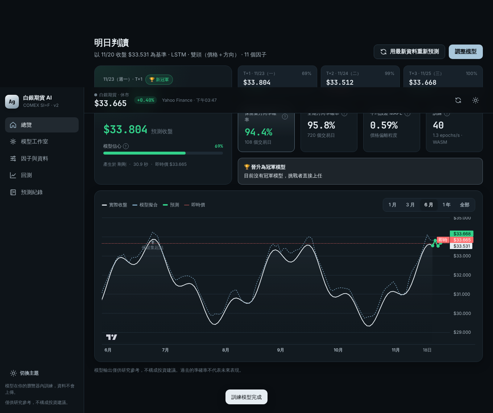
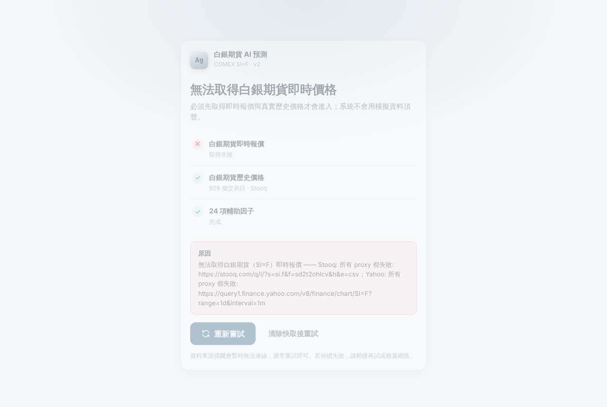
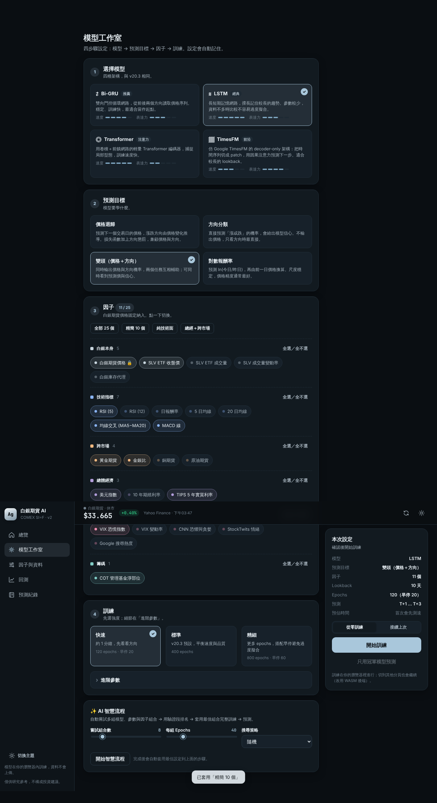
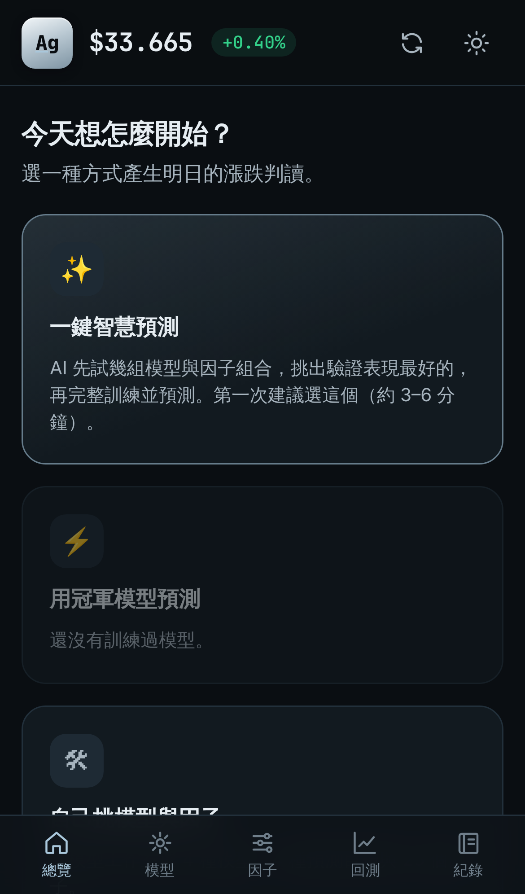

# 白銀期貨 AI 預測 · v2

以 v20.3 的**模型選項**（BiGRU／LSTM／Transformer／TimesFM、四種預測目標）與 **25 個因子**為基礎，重新設計的網頁版預測系統，重點在 UI／UX。所有訓練都在瀏覽器內進行。

**網址**：https://frk618-ship-it.github.io/silver-ai-trader/v2/



> 截圖使用測試用的假行情。

## ⚠️ 第一次使用：先建立資料中繼

瀏覽器不能直接讀取 Yahoo／Stooq 的資料，網路上免費的公開中繼也已失效。請依 [`worker/README.md`](../worker/README.md) 用 Cloudflare 免費建立自己的中繼（約 5 分鐘），
再把網址貼到進站畫面或「因子與資料」頁的「資料中繼網址」，按「測試並儲存」。

## 使用流程

1. **開啟**：自動連線。必須先取得**白銀期貨即時報價**與**真實歷史價格**才會進入，畫面以清單顯示每一步的進度；失敗時說明原因並可重試，不會用模擬資料頂替。第二次開啟會先確認即時報價，再用上次的資料**立即進入**，最新行情在背景更新。
2. **總覽**：第一次會看到三個入口：
   - 一鍵智慧預測
   - 用冠軍模型預測
   - 自己挑模型

   有結果後顯示：
   - 「明日判讀」大卡：看漲／看跌、預測價、模型信心
   - T+1…T+N 每日卡片
   - 保留集準確率等指標，滑鼠移到 ? 有說明
   - 價格圖：實際收盤、擬合、預測、即時價，並標出保留集起點
3. **模型工作室**：四步驟（模型 → 預測目標 → 因子 → 訓練）。
   - 模型與目標用卡片選擇，附白話說明與速度／表達力指標。
   - 25 個因子分成 6 組色塊，有「全部／精簡／技術面／總經」預設可一鍵套用。
   - 訓練強度有快速／標準／精細三種，細節收在「進階參數」。
   - 右側摘要會顯示預估時間。
4. **訓練**：右下角浮動面板，可以縮小，訓練時照樣能瀏覽其他頁。面板顯示：
   - 進度環、epoch、loss、速度、剩餘時間
   - 即時 loss 曲線
   - **停止**按鈕，可以真的中途停止

   切到背景分頁會自動改用 WASM 繼續跑；完成後若有授權，會發送系統通知。
5. **AI 智慧流程**：自動嘗試多組模型、參數、因子組合，用驗證段排名，再套用最佳組合完整訓練並預測。
6. **因子與資料**：
   - 每個資料來源是「真實」還是「補位」
   - 25 個因子的最新值、20 日變化、60 日走勢小圖
   - 因子影響力圖
7. **回測**：滑桿設定手續費、滑價、槓桿、門檻、放空。結果包含：
   - 策略報酬與買進持有對照
   - 最大回撤、Sharpe、勝率
   - 權益曲線、交易明細（可下載 CSV）
8. **預測紀錄**：每次預測自動記下，實際收盤出來後自動對帳。這一頁顯示：
   - 實測準確率
   - 重新訓練建議
   - 模型註冊表（冠軍／挑戰者）、執行紀錄

其他：深色／淺色主題（跟隨系統，可切換）；手機有底部分頁列；設定與上次結果自動保存。

| 閘門 | 模型工作室 | 手機 |
| --- | --- | --- |
|  |  |  |

## 與 v20.3 相同

- 4 種模型、4 種預測目標、25 個因子、方向懲罰 Huber loss
- 時序保留集與冠軍／挑戰者晉升規則
- 資料來源與 CORS proxy 輪替

資料抓取與模型程式碼直接取自 V20.4（含融合 RNN 與自動選後端的加速）。

## 修正與改進

- **交叉驗證**：改為時序前推，只用過去資料訓練、測下一段，避免高估。
- **AI 搜尋**：每組都用最後 20% 驗證排名，不再用訓練資料本身排名。
- **Transformer 在 WASM 上無法訓練**：WASM 後端缺卷積反向傳播的 kernel。現在會自動避開 WASM，背景分頁也改用 CPU。
- **TimesFM 記憶體洩漏**：每建一次模型會留下注意力遮罩，已修正。
- 模型存在 IndexedDB，而不是 localStorage，避免容量上限。
- 所有函式庫鎖定版本：TF.js 4.22.0、Lightweight Charts 4.2.0。

## 檔案

```
v2/
├── index.html      外殼與函式庫
├── css/app.css     設計系統（深色／淺色、響應式）
├── js/engine.js    資料來源、即時報價閘門、模型、資料集、預測（取自 V20.4）
├── js/config.js    模型／目標／因子選項與預設
├── js/pipeline.js  訓練 → 預測 → 保留集裁決 → 紀錄；回測；AI 搜尋
├── js/charts.js    圖表
├── js/app.js       介面
└── tests/e2e.js    端到端測試（Playwright，假行情）
```

## 測試

```bash
cd v2/tests
npm i playwright @tensorflow/tfjs@4.22.0 @tensorflow/tfjs-backend-wasm@4.22.0 lightweight-charts@4.2.0
node e2e.js
```

共 20 項檢查：
- 閘門：無即時報價時擋下、報價過舊時擋下
- 主流程：訓練 → 判讀 → 回測 → 因子 → 紀錄
- 主題切換
- 快照快速開啟
- 手機版面不會水平捲動

⚠️ 模型輸出僅供研究參考，不構成投資建議。
